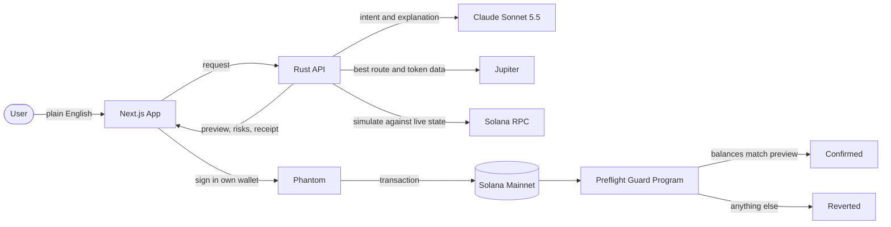

# Preflight

### Every Transaction, Explained Before You Sign.

**An AI copilot for Solana that turns plain English into safe, simulated, verifiable transactions.**

`AI Track` · `DeFi Track` · `Built for the Solana Hackathon, November 2026`

---

## The One-Line Pitch

You tell Preflight what you want: *"swap half my SOL to USDC"*. It finds the best route, **runs the exact transaction against live Solana mainnet before you sign**, explains every effect in plain language, flags anything dangerous, and can lock that preview on-chain so the transaction **cannot do anything you didn't approve**.

---

## The Problem: Crypto Asks People To Sign Blind

Every day, millions of wallet pop-ups ask people to approve a wall of hexadecimal they cannot read. The wallet says *"Approve transaction?"*, and the user has two choices: trust the website, or don't use crypto.

That gap is where most of the pain in crypto lives:

- **Wallet drainers** hide an *"unlimited spending approval"* inside a harmless-looking "claim your airdrop" button.
- **Impostor tokens** copy the ticker of a popular coin, and people buy the wrong one.
- **Honeypot tokens** let you buy but secretly keep the power to freeze your balance so you can never sell.
- **Bad trades** quietly lose money to price impact and loose slippage settings nobody explained.
- **Plain confusion** stops normal people from using on-chain finance at all. The interface is built for engineers, not humans.

The industry's answer so far has been warnings written for experts. We think the answer is a copilot that speaks human, checks reality, and refuses to let a transaction lie.

---

## The Solution: A Preflight Check For Your Money

Pilots don't take off on trust. They run a preflight check. We built the same ritual for every Solana transaction.

| Step | What Preflight Does | Why It Matters |
|---|---|---|
| **1. Understand** | Claude reads your request in plain English and turns it into one precise action. | No jargon, no forms, no mistakes from clicking the wrong token. |
| **2. Route** | Jupiter finds the best price across every major Solana exchange. | You get a fair deal without comparing ten apps. |
| **3. Simulate** | The *exact* transaction is executed against live mainnet state, without spending anything. | You see real balance changes, not estimates or promises. |
| **4. Explain** | A risk engine runs 20+ checks, and Claude explains the result like a knowledgeable friend. | You understand what you're signing in seconds. |
| **5. Guard** | A Rust program on Solana enforces the preview: if reality differs, the whole transaction reverts. | The preview becomes a guarantee, not a guess. |

Then **you** sign in your own wallet. Preflight never holds keys or funds.

---

## What Makes It Different

### The Preview Is Binding, Not Just Informative
Most safety tools show a simulation and hope nothing changes before the transaction lands. Preflight goes further. Our on-chain **Preflight Guard** program runs as the final instruction of the transaction and checks that your balances ended up within what you approved. If anything was tampered with, injected, or front-run beyond your limits, **Solana reverts everything atomically**. Users can even press *"Try To Tamper With It"* to watch a hidden theft get blocked.

### Every AI Answer Comes With A Receipt
A fingerprint of each analysis is written into the transaction itself. Anyone can later prove exactly what the user was shown before they signed. That is **verifiable AI**, not a chatbot's word.

### The AI Can Raise Alarms, Never Silence Them
Claude writes the explanation, but a deterministic rule engine sets the minimum risk level. The AI is allowed to be *more* cautious than the rules, never less. Text that comes from inside a transaction or token name is treated as untrusted, so a scammer can't prompt-inject their way to a green checkmark.

### A Scam X-Ray For Any dApp
The **Inspector** takes any transaction a website asks you to sign and tells you what it really does, including the tricks drainers use: unlimited approvals, account takeovers, hidden transfers, and fake airdrop messages.

---

## Who It's For

- **Newcomers** who want to use Solana without learning to read transactions.
- **Everyday traders** who want the best route and an honest explanation of what a swap costs.
- **Anyone who has been phished**, or is afraid of being phished, and wants a second pair of eyes before every signature.
- **Wallets and dApps** that could embed this "explain before sign" layer for their own users.

---

## Why Solana

Preflight is only possible on a chain that is fast, cheap, and composable.

- **Sub-second finality.** A user can go from a sentence to a confirmed trade in about the time it takes to read the explanation. Simulation results stay fresh because blocks land every few hundred milliseconds.
- **Fractions of a cent in fees.** Adding a guard instruction and an on-chain receipt to every transaction costs almost nothing, so safety doesn't have to be a premium feature.
- **Atomic transactions.** Solana executes every instruction in a transaction together or not at all. That single property is what lets Preflight Guard turn a preview into a guarantee.
- **Composability.** We don't reinvent exchanges or tokens. Preflight composes Jupiter, the SPL Token programs, and the Memo program with our own guard program into something none of them do alone.
- **Simulation as a first-class feature.** Solana's RPC can dry-run any transaction against current state, which is the foundation of "show, then sign".

## Why AI, And Why Claude

AI does two jobs here that rules alone can't:

1. **Understanding intent.** "Swap half my USDC", "buy $5 of JUP", "is this token a rug?" all map to precise, structured actions. Claude Sonnet 5.5 returns strict structured output, so the AI's job is parsing, never inventing addresses or amounts. Every address it returns must appear in what the user actually typed.
2. **Explaining consequences.** Raw simulation data is accurate but unreadable. Claude turns balance diffs, token audits, and risk flags into a short, honest explanation and a clear recommendation.

The AI never touches keys, never signs, and never decides the final risk level on its own.

---

## Architecture

---

## Tech Stack, And Why We Chose It

| Layer | Technology | Why We Chose It |
|---|---|---|
| **On-chain program** | Rust with **Pinocchio** | Zero-dependency, tiny, compute-efficient programs. A guard that runs on every transaction must be cheap and impossible to bloat. |
| **Backend** | Rust with **Axum** and Tokio | Memory-safe, fast, and a natural fit for byte-level Solana work. We compile and decode Solana transactions ourselves, so nothing is a black box. |
| **AI** | **Claude Sonnet 5.5** (Anthropic) | Strong reasoning, reliable structured outputs, and a fast response time that keeps the whole flow under ten seconds. |
| **Routing and token intelligence** | **Jupiter** | Best-price routing across Solana's liquidity, plus token verification, liquidity, holder, and audit data for our risk engine. |
| **Chain access** | Solana RPC (**Helius**) | Reliable mainnet simulation, account reads, and live network stats. |
| **Frontend** | **Next.js 16**, React 19, Tailwind CSS 4 | A responsive, accessible interface with light and dark themes, live streaming progress, and smooth motion. |
| **Wallet** | Solana **Wallet Adapter** (Phantom and others) | Users sign in the wallet they already trust. Preflight is fully non-custodial. |

---

## Built With Safety As A Feature

A safety product has to be safe itself. We ran an independent security review and fixed what it found before submission:

- The local API only accepts requests from the Preflight app, listens only on the user's own machine, and limits concurrent work.
- API keys can never leak through error messages.
- Before the wallet even opens, the app re-checks that the transaction belongs to the connected wallet.
- Every final transaction is simulated byte-for-byte before it is offered for signing, so what you sign is exactly what was checked.

---

## Results From Live Mainnet Testing

- **Under ten seconds** from a typed sentence to a routed, simulated, explained, and receipt-stamped swap.
- **About eight seconds** for a full token safety report with on-chain authority audit.
- **Network fees around 0.000005 SOL** for a guarded, receipted transaction.
- A simulated **wallet drainer** is flagged as high risk, with every trick it uses named in plain language.

---

## What We Want Judges To Try

1. Ask *"Is BONK safe?"* and watch the audit and AI verdict assemble step by step.
2. Ask *"Swap 0.05 SOL to USDC"* and read the preview: what you pay, what you receive, what changes in the wallet, and why it's safe.
3. Press **"Try To Tamper With It"** to see a hidden transfer injected and stopped.
4. Open the **Inspect** tab, load the sample wallet drainer, and see how Preflight exposes it.
5. No wallet? Use the **demo wallet** to explore everything with real mainnet data in view-only mode.

---

## What's Next

- **Deploy Preflight Guard to mainnet** for every user, so all previews are binding by default.
- **A browser extension** that intercepts any dApp's signature request and runs the Preflight check automatically.
- **Wallet partnerships**, offering "explain before sign" as an embeddable layer for wallets.
- **Autonomous agents with guardrails**, where an AI agent can trade within on-chain limits a human approved once.
- **More actions**: staking, limit orders, and payments, each with the same simulate-explain-guard loop.

---

**Preflight**: because nobody should have to sign something they can't read.

Built by [Taaran18](https://github.com/Taaran18) for the Solana Hackathon, November 2026.

